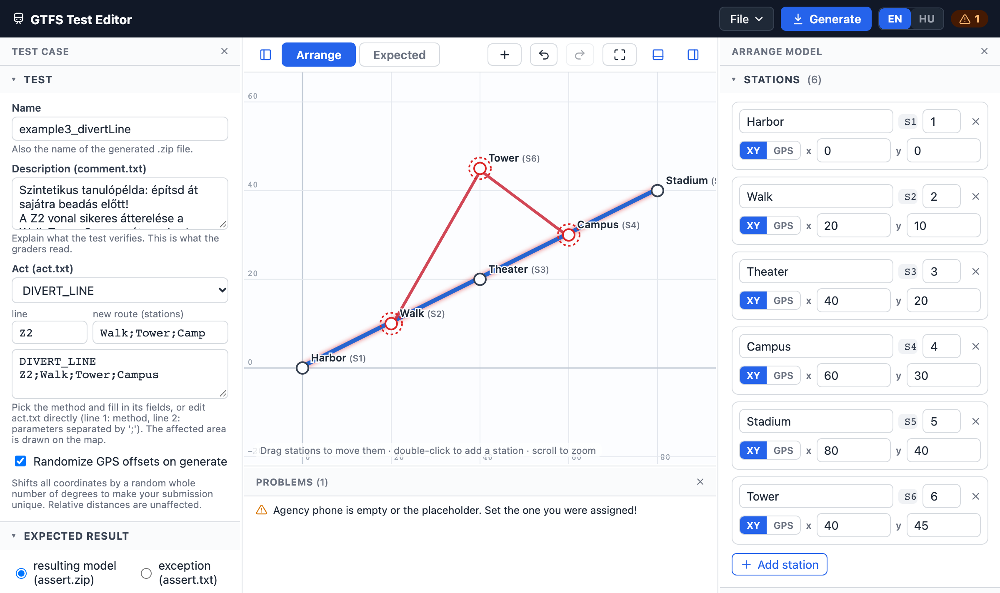

# GTFS Test Generator

A visual tool for creating GTFS test cases (arrange / act / assert) for the Szoftech university assignment, so you don't have to hand-write `stops.txt`, `stop_times.txt` and friends.

## 🌐 Web editor (nothing to install)

Open the editor in your browser at the hosted instance your instructor/maintainer provides. Everything runs locally in your browser; nothing is uploaded anywhere. Running your own instance needs Node, see *Development* and *Hosting* below.



### What it does

- **IDE-style layout**, modeled on IntelliJ IDEA: the Test case panel on the left, the Arrange/Expected model on the right, Problems under the map. Drag the gaps to resize, hide a panel with its − button and bring it back from the stripe on the screen edge (Test case, Model) or from the bar under the map or the problems counter in the status bar (Problems); your layout is remembered. Light, dark or system theme. On phones the map stays pinned on top and the panels scroll below it.
- **Visual map** of your test network: lines are drawn in their colors, stations are draggable, double-click adds a station, scroll zooms.
- **Act preview**: a `CLOSE_AREA` radius is drawn as a dashed circle on the map, and the stations/line of a `DIVERT_LINE` call are highlighted, so you can *see* what your test affects. The method and exception pickers have a search box, and *Custom…* takes any name; a method the editor doesn't know gets no checks or map drawing.
- **Panel editors**: the Test case panel holds the name, description, act, expected result and agency; the model panel holds stations, lines (with ordered stops), calendars and trips.
- **GPS ⇄ XY toggle per station**: place stations in meters on a grid (easy) or in real GPS coordinates; conversion matches the Java generator exactly.
- **Arrange / Expected tabs**: edit the before-model and the after-model separately, or pick an expected **exception** instead. "Copy Arrange → Expected" saves you from re-entering everything.
- **Undo / redo** (↶ ↷ in the map toolbar, or Ctrl/Cmd+Z and Ctrl/Cmd+Shift+Z or Ctrl/Cmd+Y while not typing in a text field) for every change, imports included. Select a station and press Delete or Backspace to remove it; Esc deselects it and ends stop picking.
- **Pick stops on map**: on a line card, press *Pick stops on map* and click stations to append them as stops in order.
- **Faded Arrange under Expected**: on the Expected tab the Arrange model is drawn faded underneath, so you see exactly what your act changes.
- **Live validation**: duplicate IDs, missing references, bad times/dates etc. are listed in the Problems panel before you generate anything.
- **One-file import/export**: the whole test case is saved as a single `.json` you can share or keep in your repo.
- **Generate**: downloads `<name>.zip` containing exactly what the grader wants:
  `comment.txt`, `act.txt`, `arrange.zip`, and `assert.zip` *or* `assert.txt`. Unzip it into your submission directory and you're done.
- **Examples built in**: *Load example* in the test-name menu (top left) contains synthetic test cases modeled on real, accepted submissions (same transformations, different layouts). Use them to learn the format, then build your own.
- **Import from a real GTFS feed**: the import button on the Model panel's header reads a full GTFS zip (a city's whole network works, hundreds of MB included) and lets you pick routes. They replace the Arrange or Expected model, whichever tab is open; platforms are merged into their stations, and each line uses its route's longest trip. Your agency settings stay as they are.
- **Import old work**: besides `.json`, *Import…* in the same menu also accepts a previously generated submission zip (`act.txt` + `arrange.zip` + …) and rebuilds an editable test case from it, or a bare GTFS zip, which opens the route picker (the picked routes replace the open tab's model).
- Your work is **autosaved** in the browser (localStorage), so an accidental refresh loses nothing.

### Quick start

1. Open the editor and pick an example under *Load example* in the test-name menu (top left) to see how a finished test looks, or *New test case* there.
2. Build the **Arrange** model: add stations on the map, create lines and add their stops in order, check the calendar dates.
3. Fill in the **agency phone number and calendar dates you were assigned**. The phone starts empty, and Generate is blocked until you fill it in.
4. Write the **Act** (first line: method name, second line: parameters separated by `;`).
5. Set the **Expected result**: either an exception name, or copy the arrange model and edit it to the state after the act.
6. Press **Generate**, unzip the download into your test directory, commit, submit, 💯 *profit*.

> [!TIP]
> Prefer XY coordinates (meters) while designing: they're what the map grid shows, and radii in `CLOSE_AREA` are meters too. The generated `stops.txt` always contains the equivalent GPS coordinates.

### Browser support

Any current Chrome, Edge or Firefox, and Safari 16.4+.

## 🛠️ Development

The editor is **Vue 3 + TypeScript**, built with **Vite**, styled with **Tailwind CSS** and **shadcn-vue** components. It needs Node 22.12 or newer (22, 24 or 26 LTS):

```
npm install
npm run dev        # http://localhost:5173, reloads on save
npm test           # the test suite (vitest)
npm run build      # type-check + production build into dist/
npm run preview    # serve dist/ locally
```

The built `dist/` must be served over http (ES modules don't load from `file://`).

**Tests** (`tests/`): every example must validate, survive a JSON round trip and generate; `feed.test.ts` covers importing from a real-world-style GTFS feed. If you keep real, accepted submissions in a local `submitted-tests/` folder (one directory per test with `act.txt`, `arrange.zip`, …), each one is also imported, regenerated and compared with the original. That folder is gitignored and never enters the Docker image.

**Examples** (`examples/`): the *Load example* entries, as plain test-case `.json` files (exactly what Export JSON produces). They are bundled at build time, so adding one means committing the file and redeploying.

### Hosting

**Recommended: the included `Dockerfile`** (built for Coolify, works anywhere Docker does). It builds the editor and serves `dist/` with nginx (`deploy/nginx.conf`). In Coolify: add the repo as an application, choose *Dockerfile* as the build pack, set the port to 80.

Any static file server works too: run `npm run build` and serve `dist/`. The build uses relative paths, so it can live under any URL path.

### The look: IntelliJ "Islands"

The editor is styled after JetBrains IDEs (IntelliJ IDEA 2025.3+): rounded tool-window islands on the window background, tool-window stripes on the edges, editor-style tabs, a status bar, Inter + JetBrains Mono. All colors come from JetBrains' theme files in intellij-community (`platform/platform-resources/src/themes/islands/ManyIslands{Light,Dark}.theme.json`); see `src/style.css`.

### Where to look for what

| Vue concept | Where |
|---|---|
| Single-file components (`<script setup>`, `<template>`, scoped `<style>`) | `src/components/*.vue`, start with `ProblemsPanel.vue` (one of the smallest) |
| Props, `v-for`, `v-if`, `v-model` | `StationCard.vue`, `TestPanel.vue` |
| `computed` with a getter **and** setter | `CalendarCard.vue` (days), `ActEditor.vue` (method) |
| Shared state without a library ("store") | `src/composables/useEditor.ts` (module-level `ref`s) |
| Watchers, debouncing, undo history (VueUse) | `useEditor.ts`: `watchDebounced`, `useManualRefHistory` |
| Template refs and `defineExpose` | `MapPane.vue` calls `map.fit()` exposed by `MapView.vue` |
| Rendering SVG declaratively | `MapView.vue`: everything drawn is `computed` from the store |
| Promise-based dialog | `useConfirm.ts` + `ConfirmDialog.vue`: `if (await confirmDialog('…'))` |
| Owning shadcn code | `src/components/ui/` is generated code you can edit; `resizable/ResizablePanel.vue` has a local fix |

The non-UI logic lives in `src/lib/` as plain typed modules (no Vue in them except the language `ref` in `i18n.ts`): the model and validation, GTFS import/export, zip, CSV and the act.txt methods.

## Repo layout

- `src/`: the editor (`components/`, `composables/` for state, `lib/` for the logic without UI)
- `examples/`: the built-in examples
- `tests/`: the test suite
- `Dockerfile` + `deploy/nginx.conf`: the container that builds and serves the editor
- `docs/`: images for this README

## Extra resources

- [GTFS reference](https://gtfs.org/documentation/schedule/reference/)
